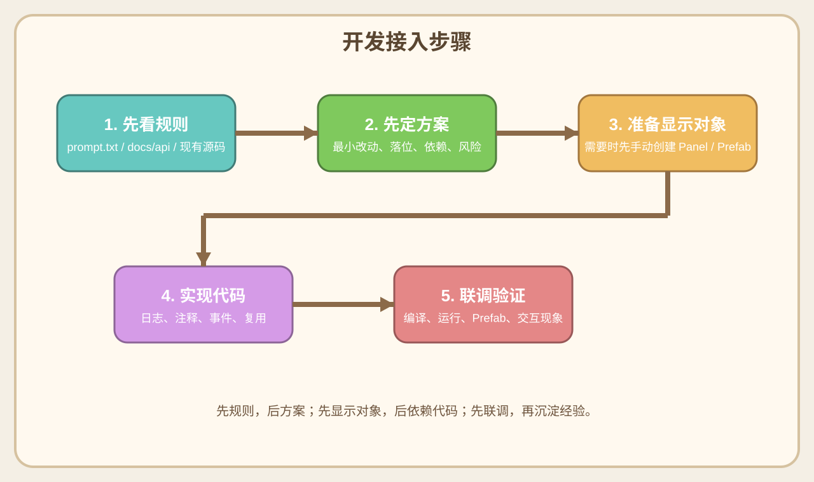

# 01. 快速上手

## 1. 你在和谁协作
- 你面对的不是“聊天机器人”，而是一个按当前项目脚手架、提示词和协作规则工作的 AI 开发助手。
- 它的默认职责是：
  - 协助开发游戏功能
  - 分析现有工程
  - 提出最小改动方案
  - 落代码
  - 同步开发所需文档
  - 在必要时帮你把稳定经验沉淀到 `prompt.txt`

## 1.1 先分清两类职责

### AI 负责的事情
- 分析需求和现有架构
- 提出最小改动方案
- 编写和修改代码
- 整理开发文档、需求文档、流程图
- 提炼可复用规则

### 开发人员手动负责的事情
- 提供目标、限制、现象和补充说明
- 在 Unity 中创建 `Panel / Prefab / 字段绑定 / Layout`
- 重新生成 `AutoGen`
- 运行项目验证现象
- 对规则和实现方向做最终确认

## 2. 开始前先看什么

### 2.1 开发人员优先参考的内容
- 当前游戏需求文档：[`requirements/requirements.md`](../requirements/requirements.md)
- 当前游戏开发方案示例：[`demo-game-setup.md`](../demo-game-setup.md)

这两份文档更适合作为开发人员的直接参考入口：
- `需求文档`
  - 解决“功能到底要做成什么样”
- `demo-game-setup.md`
  - 解决“在当前项目里准备怎么落”

### 2.2 AI 在分析需求时会优先看的内容
- [`prompt.txt`](../prompt.txt)
- [`docs/api/INDEX.md`](../docs/api/INDEX.md)
- 项目内相关源码

说明：
- 这部分主要是 AI 的工作入口，不是要求开发人员每次都先通读。
- 开发人员只需要知道：AI 会优先按这些规则和资料来分析与实现。

## 3. 你应该怎么给 AI 提需求
- 直接说目标，不用先给完整实现方案。
- 如果是新功能，建议至少说清：
  - 业务目标
  - 影响范围
  - 是否需要 UI
  - 是否需要配置
  - 是否需要可视化编辑器
- 如果你已经知道限制条件，也要一开始说清。

### 推荐表达方式
- “先给我一个最小改动方案，再开始改代码。”
- “这块先不要写代码，先确认交互流程。”
- “这条如果适合沉淀成项目全局规则，整理给我确认。”
- “这块需要用现有脚手架能力，不要另起框架。”

### 这一节里谁负责什么

#### AI 负责
- 把你的输入整理成清晰方案
- 找出还没确认的关键问题
- 提醒你哪些地方有风险或冲突

#### 开发人员负责
- 把目标和边界说清楚
- 对关键口径拍板
- 在候选规则和方案中做最终确认

## 4. 什么时候 AI 会先停下来
- 需要新增任何可见对象时
- 发现已有同名脚本时
- 遇到 `TODO-AI` 时
- 进入复杂区域但实现边界不清时
- 规则需要先确认时

这些停点不是中断开发，而是为了避免无效返工。

## 5. 什么时候你需要手动配合
- 创建 `Panel / Prefab`
- 重新生成 `AutoGen`
- 调整预制体字段绑定
- 在 Unity 编辑器里配置材质、颜色、Layer、Layout 参数
- 验证运行效果并反馈现象

说明：
- 这些都属于开发人员手动职责。
- AI 可以告诉你要做什么，但不能替你在编辑器里完成这些操作。

## 6. 最常见的协作模式

### 模式 A：先方案后编码
适合：
- 新功能
- 架构敏感区域
- 影响多个模块的需求

步骤：
1. 你提需求
2. AI 给最小改动方案
3. 你确认
4. AI 再改代码

### 模式 B：直接落代码
适合：
- 小范围修复
- 明确的单点需求
- 已经确认过口径的延续工作

### 模式 C：先文档后开发
适合：
- 玩法还在细化
- 需求有很多边界情况
- 需要先让策划、开发、测试对齐

## 7. 这套协作里最重要的 8 条
- 不绕开现有脚手架
- 不直接手改 `AutoGen`
- 业务逻辑优先走 `Module + Event + Panel`
- 显示对象先手动创建
- `TODO-AI` 先设计后实现
- 日志和注释必须跟上
- 复杂区域先梳理再落代码
- 适合跨项目复用的规则要沉淀到 `prompt.txt`

## 8. 快速上手流程图

