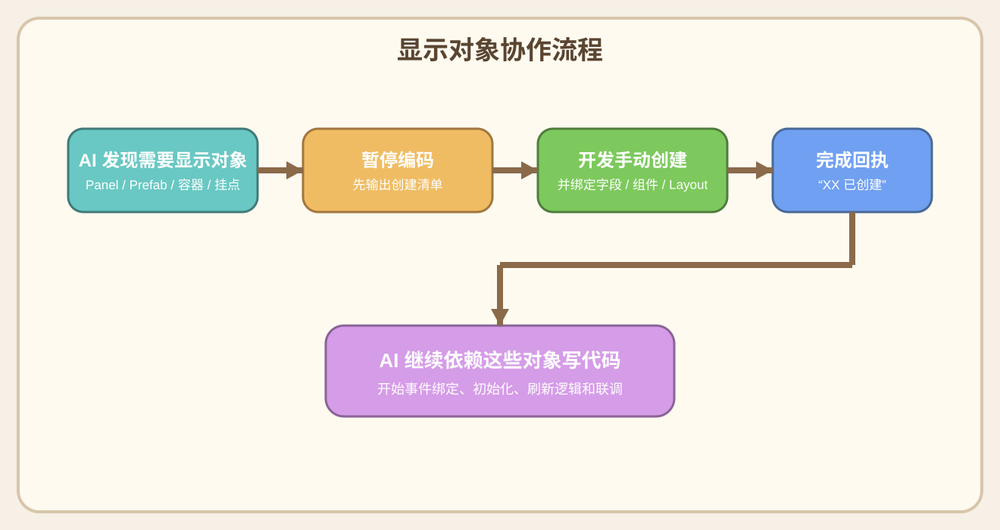

# 02. 协作流程

## 1. 标准开发流程
1. 明确需求目标
2. 先做需求整理与需求落地
3. 判断需求归属层
4. 先读规则与 API 文档
5. 先产出开发方案文档
6. 多轮沟通确认开发方案
7. 确认是否需要手动创建显示对象
8. 编码实现
9. 联调与修正
10. 如有通用价值，沉淀到 `prompt.txt`

## 1.1 优先级原则
- 当需求还处于模糊、零散、口头描述为主的状态时，需求整理与需求落地优先于代码开发。
- 只有当需求已经整理到“开发可直接使用”的程度后，才进入正式编码阶段。
- 如果跳过这一步直接开发，后续返工概率会明显升高。
- 需求整理完成后，也不是直接开始编码，而是先进入“开发方案协作阶段”。

## 1.3 开发方案协作流程图


## 1.2 每个阶段谁负责什么

### AI 负责
- 梳理需求骨架
- 分析归属层和最小改动方案
- 编码实现
- 同步开发文档
- 提炼可复用经验

### 开发人员负责
- 给出目标和边界
- 手动创建显示对象和配置资源
- 在编辑器中调整绑定和参数
- 运行、验证、反馈现象
- 对关键实现方向做确认

## 2. 需求归属层怎么判断
- 启动流程问题：`Procedure`
- 全局能力问题：`System`
- 玩法业务问题：`Module`
- 界面交互问题：`Panel / View`
- 配关和工具问题：`EditorWindow`
- 配置读取问题：配置系统或 `ScriptableObject`

## 3. 开发过程中 AI 的标准动作

### 3.1 先分析，不盲改
- 看 `prompt.txt`
- 看 `docs/api`
- 看现有脚本和目录结构
- 决定最小改动落点

### 3.2 再确认边界
- 需不需要新显示对象
- 是否已有同名脚本
- 是否已有现成组件可复用
- 是否涉及 `TODO-AI`

### 3.3 先整理开发方案
- 先产出开发方案文档，不直接跳到编码
- 开发方案建议参考当前项目里的 `demo-game-setup.md` 组织方式
- 方案输出位置统一放在 `ai-doc/develop-setup` 目录
- 文档格式使用 `md + svg`
- 经过多轮沟通确认没问题后，再进入代码实现

### 3.4 再开始实现
- 优先改已有脚本
- 新增脚本时补日志和注释
- UI 通过事件接收刷新

## 4. 显示对象协作流程



### 4.1 规则
- AI 不能假设场景里已有想要的显示节点
- 需要显示对象时，必须先列清单
- 你手动创建完成后，AI 才继续依赖这些对象写代码

### 4.1.1 AI 负责
- 判断当前实现是否需要新的显示对象
- 输出对象清单、路径、字段、组件和结构建议
- 在你创建完成后继续接代码

### 4.1.2 开发人员负责
- 在 Unity 中手动创建对象
- 补字段绑定、布局组件、材质与参数
- 创建完成后明确告知 AI

### 4.2 你通常会收到什么清单
- 预制体路径
- 预制体名称
- 建议字段名
- 用途说明
- Layout 建议
- 需要挂的组件

## 5. `TODO-AI` 流程
1. AI 发现 `TODO-AI`
2. 先解释这段要怎么实现
3. 你确认方案
4. AI 开始落代码
5. 完成后改成 `AI-DONE`

## 6. 什么情况下会建议拆文件
- 一个模块脚本过长
- 一个编辑器窗口职责过多
- 一个面板脚本同时管初始化、刷新、交互、缓存
- 某一块逻辑后续还会继续扩张

常见拆分方式：
- `partial`
- `Logic / Logic2`
- `Refresh / Input / Editor`

## 7. UI 刷新协作原则
- 初始化级刷新和局内轻刷新要分开
- 普通点击不要触发整块重建
- 布局依赖位置的逻辑要在布局刷新完成后再做
- 静态线、动态高亮、状态刷新最好分层处理

## 8. 失败时怎么排查
- 先看编译错误
- 再看运行时报错堆栈
- 再看日志节点是否进入
- 再判断是配置问题、Prefab 问题、事件链路问题还是业务状态问题

## 9. 给 AI 反馈问题的推荐方式
- “编译错误，报错如下：……”
- “运行后点击 13 出现这个效果，期望是……”
- “这个流程不对，请按需求文档第 13.1 节理解”
- “这条如果能沉淀成项目全局规则，整理给我确认”

## 10. 一句话分工原则
- AI 主要负责“分析、设计、实现、整理”。
- 开发人员主要负责“确认、创建、调整、验证、反馈”。

## 11. 两个关键协作节点的提示词模板

### 11.1 节点一：首次需求输入（提出需求）
这个节点适用于：
- 新玩法刚开始立项
- 需求还比较模糊
- 只有示意图、参考图、玩法想法、口头描述

这个阶段的目标不是直接写代码，而是先进入“需求整理与需求落地”。

#### 开发人员最小只需要准备两样东西
- 游戏主玩法界面的示意图
  - 需要包含 UI 和游戏界面布局
  - 最好是 `1-3` 张不同状态的图
- 游戏主玩法描述
  - 用一段话说清核心玩法即可

#### 更理想但不是必须的补充
- 一份完整的 `PDF` 或 `Word` 文档
- 参考产品截图
- 少量补充规则

#### 可直接复制的提示词模板
```txt
你现在先不要写代码，先进入“需求整理与需求落地”模式。

我现在给你的不是完整需求，而是一个初始玩法想法，请你先帮我把它整理成开发可直接使用的需求文档。

已知输入如下：
1. 游戏主玩法界面示意图：
   - 包含 UI 和游戏界面布局
   - 可以是 1-3 张不同状态的图
2. 游戏主玩法描述：
   - 用一段话描述核心玩法

可选补充：
3. PDF / Word 需求文档（如果有）：
4. 参考产品（如果有）：
5. 其他零散规则（如果有）：

你的工作要求：
1. 先帮我抽象核心玩法骨架。
2. 列出当前最关键的待确认问题，不要一次问太多。
3. 把已确认内容持续整理进需求文档。
4. 如果界面结构需要表达，请同步输出 SVG 草图。
5. 需求整理与需求落地优先于代码开发，这一阶段不要直接进入编码。
```

#### AI 在这个节点应该产出的东西
- 一版核心玩法骨架
- 一批关键待确认问题
- 一版需求文档初稿
- 必要时的 SVG 草图

### 11.2 节点二：需求协作完成后，进入开发协作
这个节点适用于：
- 需求已经基本整理完
- 文档、草图、规则已经足够支撑开发
- 准备进入正式开发方案阶段

这个阶段的目标是：先分析归属层，产出开发方案文档，多轮沟通确认，确认没问题后再进入代码实现。

#### 这个节点的开发方案产出要求
- 先参考当前项目里的 [`demo-game-setup.md`](../demo-game-setup.md)
- 新项目或新功能的开发方案统一保存到 `ai-doc/develop-setup` 目录
- 开发方案使用：
  - `md` 文档
  - `svg` 示意图
- 在开发方案经过多轮沟通确认前，不进入正式编码阶段

#### 可直接复制的提示词模板
```txt
现在需求协作已经基本完成，下面进入开发协作阶段。

你的工作要求：
1. 先判断需求归属层（Module / Panel / System / Editor / Config）。
2. 先参考 demo-game-setup.md 的组织方式，帮我产出一版开发方案。
3. 开发方案保存到 ai-doc/develop-setup 目录，并使用 md + svg 的格式呈现。
4. 先和我多轮沟通确认开发方案，确认没问题后再开始改代码。
5. 如果需要新增显示对象，先暂停并列出需要我手动创建的对象清单。
6. 如果发现已有同名脚本，先暂停并告诉我，优先复用已有脚本。
7. 代码实现时遵守当前项目脚手架、事件驱动、日志和注释规则。
8. 如果某条经验适合沉淀成项目全局规则，再整理给我确认。
```

#### AI 在这个节点应该产出的东西
- 需求归属层判断
- 一版开发方案文档
- 配套 SVG 示意图
- 多轮沟通后的最终开发方案
- 需要手动创建的对象清单
- 代码实现与联调步骤


