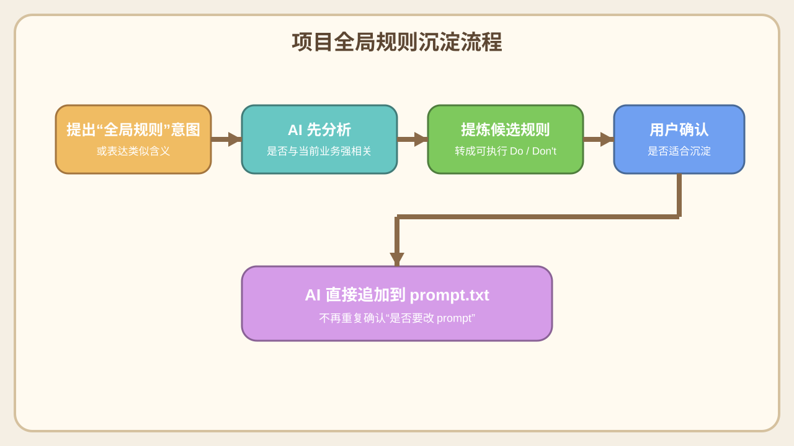

# 04. 提示词与规则沉淀

## 1. `prompt.txt` 是做什么的
- 它不是需求文档。
- 它是当前项目和后续同类项目的“开发协作规则底座”。
- 但它不是这套手册的主角，也不是日常开发的第一目标。
- 日常工作的主目标仍然是把游戏功能开发出来；`prompt.txt` 维护属于附带沉淀动作。
- 用来约束：
  - 架构边界
  - 开发习惯
  - 文档优先级
  - UI 协作方式
  - AI 的执行流程

## 2. 什么内容适合沉淀到 `prompt.txt`
- 和某个具体游戏玩法无关
- 但在这次项目中证明非常有效
- 下一个项目也大概率继续适用
- 能转成稳定的 Do / Don't 规则

例如：
- 显示对象先手动创建
- `TODO-AI` 的处理流程
- 事件驱动 UI
- `Item` 和自定义组件的选型规则

## 3. 什么内容不适合沉淀到 `prompt.txt`
- 某个具体游戏节点名
- 某个玩法专属状态机名
- 某个脚本的参数签名
- 某个关卡的特殊表现规则

这些更适合留在：
- 需求文档
- 开发方案文档
- 当前项目实现代码里

## 4. 如何触发“全局规则沉淀”
- 你只要提到：
  - `项目全局规则`
  - 或类似“这个下个项目也通用”“这个应该沉淀为通用规则”
- AI 就会自动做三件事：
  1. 判断这条是否和当前游戏业务强相关
  2. 判断它是否适合跨项目复用
  3. 整理成候选规则给你确认

你确认后，AI 会直接追加到 `prompt.txt`。

## 5. 规则沉淀流程图

## 6. 如何维护规则质量
- 规则要能执行，不要太抽象
- 规则要尽量短，但要能落地
- 规则一旦确认，就尽量避免反复改表述
- 如果新规则和旧规则冲突，优先保留新规则并清楚替换旧口径

## 7. 推荐的沉淀提问方式
- “这个能否作为项目全局规则整理出来？”
- “这次的经验里哪些适合放进 prompt？”
- “这条和游戏业务无关，帮我提炼成通用规则。”

## 8. 新同学最容易混淆的点
- `prompt.txt` 不是需求文档
- `需求文档` 不是开发规则
- `demo-game-setup.md` 不是跨项目模板
- 规则沉淀不是越多越好，而是越稳越好

