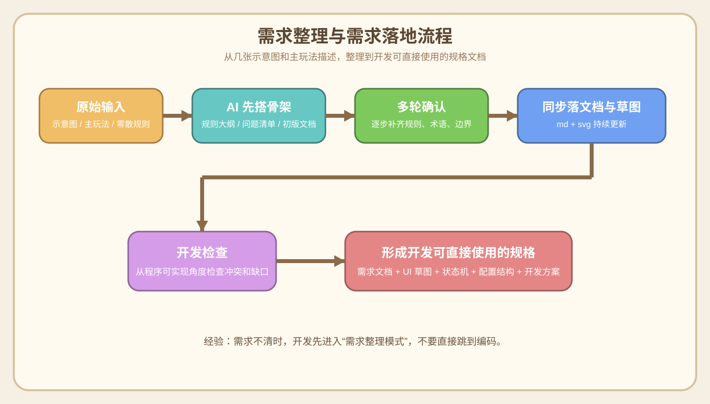
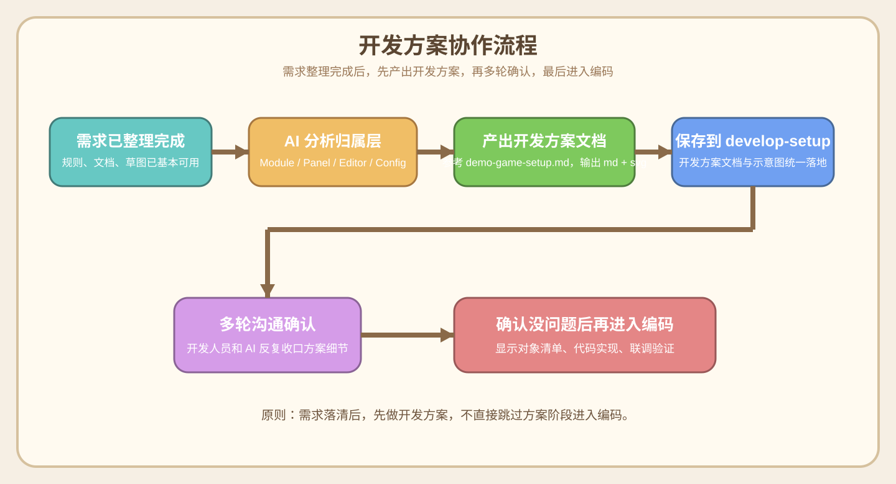

# 05. 需求整理与需求落地

## 1. 为什么这一节很重要
- 需求整理与需求落地优先于代码开发。
- 在很多小游戏项目里，最开始拿到的并不是完整需求文档。
- 更常见的情况是：
  - 几张示意图
  - 一段主玩法描述
  - 几条零散规则
  - 一些“我想要这种感觉”的口头表达
- 这时候，开发人员不能直接开写代码。
- 需要先和 AI 一起，把模糊想法整理成开发可直接使用的需求文档。

## 1.1 优先级结论
- 如果需求还没有被整理成可执行规格，开发人员的第一职责不是“先写一版试试”，而是先推动需求落地。
- 需求整理完成前，可以做调研、做方案、做技术预研，但不应该进入正式业务实现。
- 这条规则适用于：
  - 新玩法立项
  - 旧玩法大改
  - 规则边界还不清晰的功能

## 2. 这次项目里已经验证过的需求整理路径
当前项目的真实过程就是：
1. 策划先给出主玩法描述和局内示意图
2. AI 先把核心玩法抽象成规则骨架
3. 再通过多轮问答，逐步补齐：
   - 关卡结构
   - 棋盘规则
   - 目标组规则
   - 补牌规则
   - 通关与失败条件
   - UI 布局规则
   - 配置结构
   - 运行时状态机
4. 最终沉淀成：
   - [`requirements/requirements.md`](../requirements/requirements.md)
   - `SVG` 线框与示意图
   - 开发方案文档

也就是说，这个阶段不是“额外工作”，而是正式开发的前置阶段。

## 3. 什么时候应该先做需求整理，而不是直接编码
- 玩法规则还在变
- 术语不统一
- UI 草图和口头描述存在偏差
- 配置结构还没明确
- 开发和策划对边界条件理解不一致
- 运行时状态流还说不清

出现这些情况时，优先做需求整理。

## 3.1 什么时候才适合正式进入编码
- 核心玩法规则已经清楚
- 关键术语已经统一
- UI 大体布局已经明确
- 配置结构已经收敛
- 状态机或核心时序已经可描述
- 文档已经足够支撑开发直接实现

满足这些条件后，再正式进入代码开发阶段。

## 4. 开发人员在需求整理阶段的角色
开发人员在这个阶段不只是“等文档的人”，而是要主动推动需求成型。

需要做的事情包括：
- 帮策划把模糊描述转成规则
- 补问关键边界
- 识别配置冗余和冲突
- 提炼术语
- 推动产出可开发文档
- 推动产出可预览 UI 草图
- 从开发角度做“开发检查”

## 4.1 需求整理阶段的职责分工

### AI 负责
- 把零散输入整理成文档骨架
- 输出待确认问题清单
- 生成和更新 SVG 草图
- 提炼配置结构、状态机和边界规则
- 做开发视角检查

### 开发人员负责
- 提供原始玩法输入、示意图和补充想法
- 对关键规则做取舍和确认
- 指出不符合开发预期或实现预期的地方
- 决定哪些结论进入正式需求文档

## 5. 推荐的需求整理流程



### 5.1 先收原始输入
常见输入包括：
- 一句话玩法描述
- 参考游戏截图
- 手绘草图
- 规则片段
- 配表想法

### 5.2 先让 AI 搭骨架
适合先让 AI 产出的内容：
- 核心玩法一句话定义
- 规则大纲
- 待确认问题列表
- 第一版需求文档结构
- 第一版局内线框图

### 5.3 多轮确认关键规则
每一轮都只收最关键的一小批问题，例如：
- 路径是否被占位阻挡
- 目标组怎么结算
- 目标组点击终点怎么判定
- 补牌规则是什么
- 失败条件是什么
- 配置里哪些字段是冗余的

### 5.4 及时落文档
- 已确认的内容，立即写进文档
- 涉及界面的内容，立即同步 SVG 草图
- 不要等全部讨论完再回头整理

### 5.5 做开发视角检查
当需求已经写得差不多时，开发人员应该再从“程序能不能直接实现”的角度检查一遍：
- 配置是否冲突
- 时序是否自洽
- 术语是否统一
- 是否仍有待确认项
- 是否有无法直接落代码的缺口

## 6. 推荐产出物
需求整理阶段建议至少落下面这些东西：

### 6.1 需求文档
- 统一放在一个固定目录
- 使用 `Markdown`
- 能配图预览
- 章节结构清晰

### 6.2 SVG 草图
- 用于局内布局
- 用于术语说明
- 用于状态流转
- 用于编辑器方案

### 6.3 开发方案文档
- 在需求已经相对稳定后，先整理成开发方案，再进入正式编码
- 开发方案的组织方式可参考当前项目里的 [`demo-game-setup.md`](../demo-game-setup.md)
- 新的开发方案建议统一保存到 `ai-doc/develop-setup` 目录
- 格式建议使用 `md + svg`

### 6.4 开发方案协作流程图



## 7. 需求整理阶段推荐让 AI 做的事
- 帮你把零散规则转成正式描述
- 帮你列待确认问题
- 帮你生成 UI 草图和状态图
- 帮你做“开发检查”
- 帮你提炼最小配置结构
- 帮你统一术语
- 帮你拆出开发状态机

## 8. 需求整理阶段不建议跳过的环节
- 术语说明
- 配置字段收敛
- 运行时状态机
- 边界情况处理
- 开发视角复查

这些环节跳过后，后面编码基本都会返工。

## 9. 推荐给 AI 的提问方式
- “先不要写代码，先把需求细化到开发可直接使用的程度。”
- “先根据我给的玩法和示意图补一版需求文档。”
- “从开发视角检查一下这份需求是否有冲突。”
- “帮我把这些规则落到 md 和 svg 里。”
- “这轮确认完后，把文档和草图同步更新。”

## 9.1 这阶段不要混淆的两件事
- AI 可以主导“整理”和“输出”。
- 但规则确认和最终拍板，仍然由开发人员或策划负责。

## 9.2 首次需求输入的标准模板

### 这个模板适合什么情况
- 只有玩法想法，没有正式文档
- 只有主场景示意图和主玩法描述
- 需要 AI 帮你把需求逐步整理成开发规格

### 最小输入要求
- 只要有下面两样东西，就可以开始：
- 游戏主玩法界面示意图
  - 包含 UI 和游戏界面布局
  - 最好是 `1-3` 张不同状态的图
- 游戏主玩法描述
  - 用一段话描述核心玩法

### 更理想但不是必须的补充
- 一份完整的 `PDF` 或 `Word` 文档
- 参考产品截图
- 少量零散规则

### 模板内容
```txt
你现在先不要写代码，先进入“需求整理与需求落地”模式。

我先给你一版初始玩法输入，请你帮我逐步整理成开发可直接使用的需求文档。

输入如下：
1. 游戏主玩法界面示意图：
   - 包含 UI 和游戏界面布局
   - 可以是 1-3 张不同状态的图
2. 游戏主玩法描述：
   - 用一段话描述核心玩法

可选补充：
3. PDF / Word 文档（如果有）：
4. 参考产品（如果有）：
5. 其他零散规则（如果有）：

要求：
1. 先整理核心玩法骨架。
2. 每轮只问最关键的一批待确认问题。
3. 需求文档持续更新，不要只停留在聊天里。
4. 需要界面表达的内容同步输出 SVG 草图。
5. 当前阶段先不进入代码开发。
```

### 开发人员手动要做的事
- 提供主玩法界面示意图
- 提供主玩法描述
- 每轮确认关键规则
- 决定哪些结论写进正式文档

### AI 要做的事
- 抽象玩法骨架
- 追问关键问题
- 输出和更新需求文档
- 输出和更新 SVG 草图

## 10. 需求整理完成的标志
当满足下面这些条件时，才适合真正进入编码阶段：
- 核心玩法已经清楚
- UI 大体布局已经定
- 关键术语已经统一
- 配置结构已经收敛
- 状态机已经可描述
- 边界规则已经基本可执行
- 文档已能支撑开发直接实现
- 开发方案已经产出并经过多轮确认

## 11. 一句话经验
- 模糊需求不是不能开发，而是要先进入“需求整理模式”。
- 开发人员和 AI 的协作，不只是写代码，也包括把模糊玩法整理成可开发规格。
- 当需求还不清楚时，需求整理与需求落地必须优先于代码开发。


