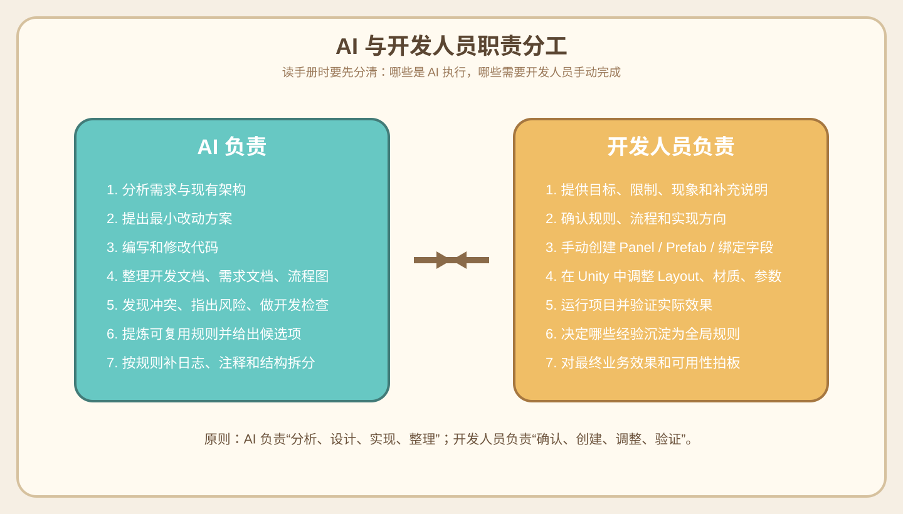
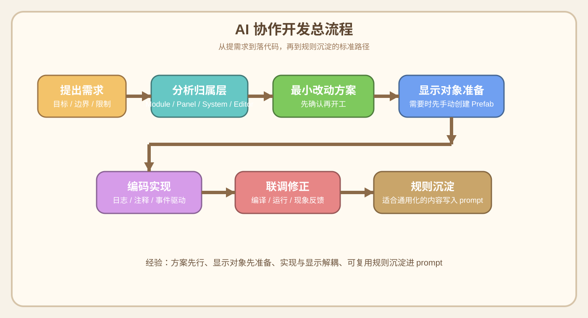

# AI 协作开发手册

## 手册定位
- 这是一份面向开发人员的 AI 协作开发手册。
- 主目标是帮助团队成员借助当前 AI 脚手架，高效完成游戏功能开发。
- 规则沉淀、提示词维护、协作文档更新属于附带产出。

## 先看哪一章

### 如果你是第一次接触这个项目
1. [01-快速上手](./01-快速上手.md)
2. [08-新人接手项目的一天.md](./08-新人接手项目的一天.md)
3. [02-协作流程](./02-协作流程.md)

### 如果当前需求还很模糊
1. [05-需求整理与需求落地](./05-需求整理与需求落地.md)
2. [02-协作流程](./02-协作流程.md)

### 如果准备正式开始开发
1. [03-项目规则与边界](./03-项目规则与边界.md)
2. [07-开发人员提问模板与反馈模板.md](./07-开发人员提问模板与反馈模板.md)

### 如果遇到问题需要排查
1. [06-常见错误案例与纠偏.md](./06-常见错误案例与纠偏.md)
2. [07-开发人员提问模板与反馈模板.md](./07-开发人员提问模板与反馈模板.md)

### 如果想把经验沉淀成规则
1. [04-提示词与规则沉淀.md](./04-提示词与规则沉淀.md)

## 关键原则
- 需求整理与需求落地优先于代码开发
- 先分清 AI 负责什么、开发人员手动负责什么
- 显示对象必须先由开发手动创建 `Panel / Prefab`
- `Module / System` 不直接操作显示对象，统一通过事件驱动 `Panel / View`
- 新增脚本要补日志字段、关键日志和 XML 注释
- 适合跨项目复用的经验要沉淀到 `prompt.txt`

## 职责分工图

## 核心流程图

### 协作总流程

### 需求整理流程

### 开发方案流程

## 目录说明
- [01-快速上手](./01-快速上手.md)
  - 新开发同学第一次进入项目时先看这里
- [08-新人接手项目的一天.md](./08-新人接手项目的一天.md)
  - 用一天的时间线说明新人如何接入这套 AI 协作方式
- [02-协作流程](./02-协作流程.md)
  - 从提需求到改代码到联调的标准流程
- [03-项目规则与边界](./03-项目规则与边界.md)
  - 当前项目里必须遵守的关键规则与边界
- [04-提示词与规则沉淀](./04-提示词与规则沉淀.md)
  - 如何把稳定经验沉淀成附带规则产物
- [05-需求整理与需求落地](./05-需求整理与需求落地.md)
  - 如何把模糊玩法整理成开发可直接使用的需求文档
- [06-常见错误案例与纠偏.md](./06-常见错误案例与纠偏.md)
  - 真实踩过的坑、原因和推荐纠偏方式
- [07-开发人员提问模板与反馈模板.md](./07-开发人员提问模板与反馈模板.md)
  - 开发人员可直接复制使用的提示词模板和反馈模板
- [09-跨项目通用 Onboarding 模板.md](./09-跨项目通用 Onboarding 模板.md)
  - 可复制到后续项目里的通用接入模板

## 一句话建议
- 如果你不知道该先看哪一章，就先看：
  - [01-快速上手](./01-快速上手.md)
  - [08-新人接手项目的一天.md](./08-新人接手项目的一天.md)
  - [05-需求整理与需求落地](./05-需求整理与需求落地.md)
  - [07-开发人员提问模板与反馈模板.md](./07-开发人员提问模板与反馈模板.md)

